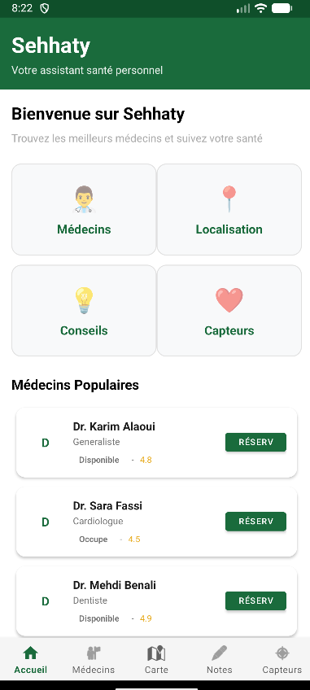
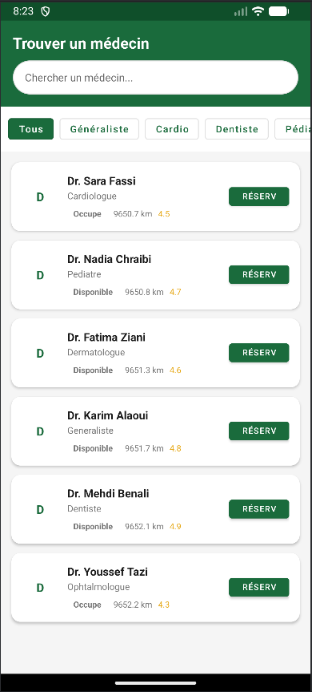
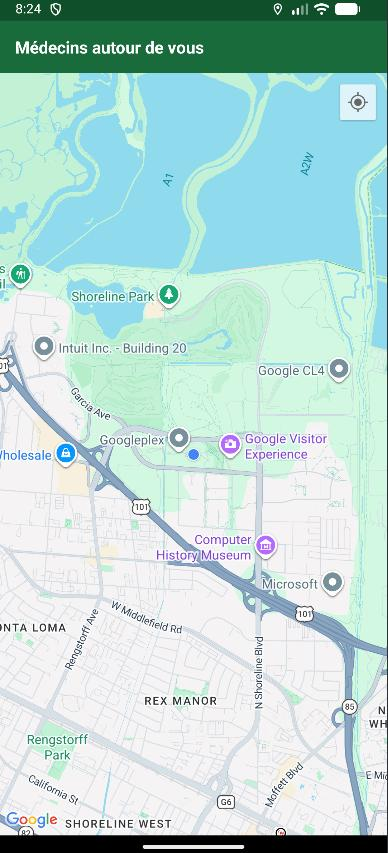
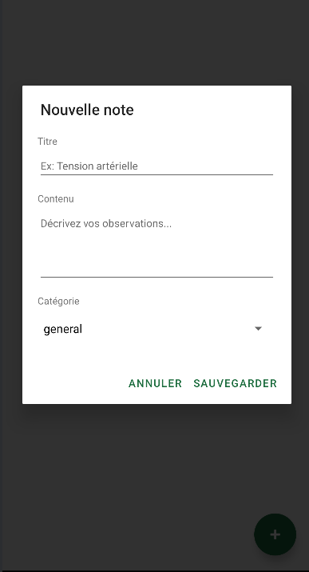
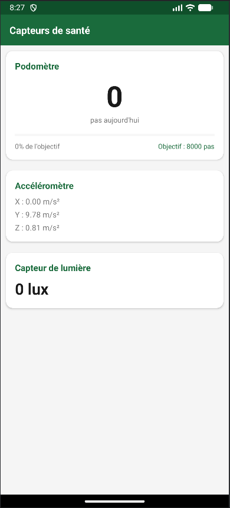
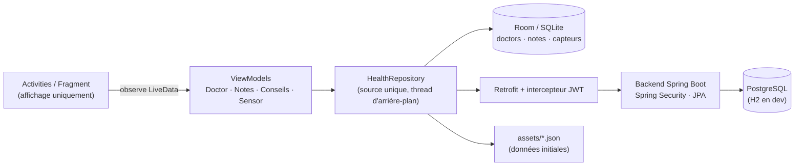

# Sehhaty 🩺 — Application Android de santé

Application mobile **Android native (Java)** pour trouver des médecins à proximité, tenir un carnet de notes médicales, suivre son activité (podomètre, détection de chute) et recevoir des conseils santé. Fonctionne **hors-ligne** grâce à une architecture *offline-first*.

> Projet réalisé en binôme (Imane Abdeljalili & Hafsa El Battioui), encadré par Adil Jeghal — version 2.0 : refonte MVVM + Room, backend Spring Boot (JWT) et CI.

<p align="center">
  
  
  
  
  
</p>

## Fonctionnalités

| Module | Détails |
|---|---|
| **Médecins** | Recherche (insensible aux accents), filtres par spécialité, tri par distance réelle (Haversine), réservation avec choix de la date et de l'heure |
| **Carte** | Google Maps, marqueurs verts (disponible) / orange (occupé), centrage sur la position |
| **Notes** | CRUD complet, catégories (tension, poids, symptôme…), mise à jour automatique de la liste |
| **Capteurs** | Podomètre avec objectif quotidien de 8 000 pas, accéléromètre + détection de chute, lumière ambiante, historique enregistré en base |
| **Conseils** | Depuis l'API, avec repli sur les données embarquées |
| **Hors-ligne** | La base Room est la source de vérité ; l'API la met à jour quand le réseau est disponible |

## Architecture (MVVM + Repository)



- **Room** est la source de vérité ; l'UI n'observe que la base via `LiveData`.
- Au premier lancement la base est initialisée depuis `assets/*.json` (Gson), puis synchronisée avec l'API.
- La logique métier (filtrage, distance, pas du jour, détection de chute) est en **Java pur**, indépendante d'Android.
- Les accès disque et réseau s'exécutent hors du thread principal (`ExecutorService`).

```
app/src/main/java/com/sante/app/
├── activity/ fragment/ adapter/   UI
├── viewmodel/                     DoctorViewModel, NotesViewModel, ConseilsViewModel, SensorViewModel
├── data/                          HealthRepository, AuthRepository, TokenStore (session JWT)
│   └── local/                     AppDatabase, DoctorDao, NoteDao, SensorDao (Room)
├── api/                           ApiClient (+ intercepteur JWT), ApiService, requêtes/réponses auth (Retrofit)
├── model/                         Doctor, Note, SensorData (entités Room), Conseil
├── util/                          DoctorFilter, StepTracker, StepProgress, FallDetector, Event
└── helper/                        LocationHelper, JsonHelper
backend/                           API REST Spring Boot 3 (Java 17) : JWT, JPA, PostgreSQL/H2, Dockerfile
```

### Backend (`/backend`)

```
com.sehhaty
├── web/         contrôleurs REST + gestion centralisée des erreurs
├── service/     logique métier (réservation, authentification, recherche de proximité)
├── repository/  Spring Data JPA
├── model/       entités JPA : AppUser, Doctor, Conseil, Appointment
├── dto/         objets d'échange validés (Bean Validation)
├── security/    JwtService (HS256), JwtAuthFilter
└── config/      SecurityConfig (stateless, BCrypt), DataSeeder
```

Points clés : mots de passe hachés (BCrypt), JWT stateless, endpoints de lecture publics, réservation réservée aux utilisateurs connectés, un utilisateur ne voit et n'annule que **ses** rendez-vous, contrainte `UNIQUE (médecin, date, heure)` en base contre les doubles réservations (409), validation des entrées (422), `JOIN FETCH` pour éviter le problème N+1.

## Lancer le projet

**Prérequis :** Android Studio (JDK 17), un émulateur ou téléphone Android 8.0+ (API 26).

1. Clone le dépôt et ouvre-le dans Android Studio.
2. Copie `local.properties.example` en `local.properties` et renseigne :
   - `MAPS_API_KEY` : clé Google Maps (restreinte au package `com.sante.app` + SHA-1 de ton keystore) ;
   - `API_BASE_URL` : `http://10.0.2.2:3000/api/` par défaut (le localhost de ton PC vu depuis l'émulateur).
3. Lance le backend (la connexion en a besoin) :
   ```bash
   # Option A, sans Docker (base H2 locale, aucun réglage) :
   cd backend && mvn spring-boot:run        # API sur http://localhost:3000/api, Swagger : /swagger-ui.html

   # Option B, Docker (API + PostgreSQL) :
   JWT_SECRET=$(openssl rand -base64 48) docker compose up --build
   ```
4. Lance l'application (▶), crée un compte puis connecte-toi.

Une fois connecté, les médecins et conseils restent consultables hors-ligne (données Room / JSON embarqué) ; la réservation exige le serveur.

> ⚠️ Ne commite jamais `local.properties` ni une clé API (voir `.gitignore`).

## API REST (contrat)

| Méthode | Endpoint | Description |
|---|---|---|
| POST | `/api/auth/register` | Créer un compte (201 + JWT / 409 email pris / 422) |
| POST | `/api/auth/login` | Se connecter (200 + JWT / 401) |
| GET | `/api/auth/me` 🔒 | Profil de l'utilisateur connecté |
| GET | `/api/doctors` | Liste des médecins |
| GET | `/api/doctors/nearby?lat=&lng=&radius=` | Médecins proches (km), triés par distance |
| GET | `/api/conseils` | Conseils santé |
| POST | `/api/appointments` 🔒 | Réserver (201 / 409 créneau pris ou médecin indisponible / 422) |
| GET | `/api/appointments` 🔒 | Mes rendez-vous |
| DELETE | `/api/appointments/{id}` 🔒 | Annuler un de mes rendez-vous (204 / 404) |

🔒 = en-tête `Authorization: Bearer <token>` requis (ajouté automatiquement par l'app).

## Technologies

Java 8 (app) · Java 17 + Spring Boot 3, Spring Security, JPA/Hibernate, JWT, PostgreSQL/H2 (backend) · Android SDK 26–34 · Room · LiveData / ViewModel · Retrofit + Gson + OkHttp · Google Maps & Location · Material Design · GitHub Actions · Docker Compose · Maven

## Feuille de route

- [x] Authentification (JWT) et comptes utilisateurs
- [ ] Écran « Mes rendez-vous » dans l'app (l'API existe déjà)
- [ ] Migrations Flyway (au lieu de `ddl-auto: update`) et refresh tokens
- [ ] Notifications de rappel de rendez-vous
- [ ] Mode sombre
- [ ] Export PDF du carnet de santé
- [ ] Migration vers un vrai backend (Spring Boot / Laravel) avec base de données
